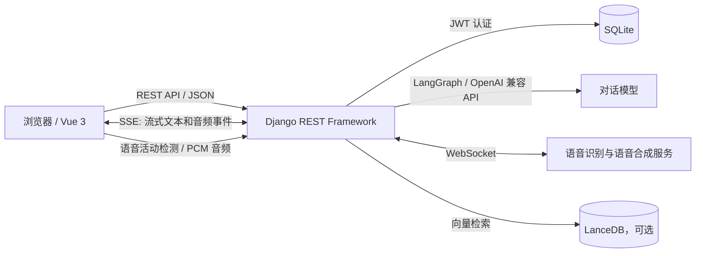

# AI Friends

**一个可以创建、发现并交流 AI 角色的对话应用。**

AI Friends 将角色设定、好友关系和持续对话结合起来：用户可以创建带有独立人设和聊天背景的角色，将角色添加为好友，并通过文字或语音交流。项目由 Vue 3 前端和 Django REST API 组成，使用 LangGraph 编排模型及工具调用，并通过 SSE 和 WebSocket 处理实时交互。

> 本项目是一个全栈 AI 应用实践，涵盖前后端分离、身份认证、流式输出、语音交互、对话记忆和向量检索。

## 项目亮点

- **角色驱动的对话：** 用户可创建并维护角色资料；会话将角色人设、记忆和近期聊天记录组合为模型上下文。
- **可编排的 AI 对话：** 使用 LangGraph 构建对话流程，并为模型提供时间查询和知识库检索工具。
- **流式文字与语音：** 后端以 SSE 推送生成中的文字，并通过 WebSocket 连接语音服务；前端逐步接收文字和音频。
- **语音输入：** 浏览器端进行语音活动检测，后端通过 WebSocket 语音识别服务将音频转换为文本。
- **完整的产品基础：** 包括账号注册与登录、JWT 认证和刷新、角色管理、好友列表、聊天历史及个人资料。
- **可选知识库：** 支持将文本切分、向量化并存入 LanceDB，供对话流程检索相关内容。

## 架构概览



**一次文字对话的处理过程**

1. 前端携带访问令牌提交角色好友 ID 和消息。
2. 后端验证用户对好友关系的所有权，将角色设定、长期记忆和最近 10 轮对话组装为模型上下文。
3. LangGraph 调用对话模型；需要时执行时间查询或知识库检索工具。
4. 后端通过 SSE 逐步发送生成内容，同时可通过 WebSocket 获取合成语音。
5. 对话内容和模型用量写入数据库，并使用模型更新该角色的长期记忆。

## 技术栈

| 层级 | 技术 |
| --- | --- |
| 前端 | Vue 3、Vite、Vue Router、Pinia、Tailwind CSS |
| 后端 | Python、Django、Django REST Framework、Simple JWT |
| 数据 | SQLite、LanceDB（可选知识库） |
| AI 编排 | LangChain、LangGraph、OpenAI 兼容 API |
| 实时交互 | Server-Sent Events（SSE）、WebSocket、浏览器端 VAD |

## 主要目录

```text
.
├── backend/
│   ├── backend/                 # Django 项目配置
│   └── web/
│       ├── models/              # 用户资料、角色、好友、消息和系统提示词
│       ├── views/               # 账号、角色、好友、聊天及语音 API
│       └── documents/           # 可选知识库的嵌入与索引逻辑
├── frontend/
│   └── src/
│       ├── components/          # 导航栏、角色卡片和聊天组件
│       ├── views/               # 首页、角色管理、聊天和用户页面
│       └── js/                  # API 客户端与前端配置
└── note/                        # 项目开发笔记
```

## 本地运行

### 环境要求

- Python 3.12 或更高版本
- Node.js 20.19+ 或 22.12+
- npm
- AI 与语音功能所需的服务凭据（详见[环境变量](#环境变量)）

### 启动后端

在项目根目录运行：

```bash
cd backend
python -m venv .venv
```

激活虚拟环境：

```powershell
# Windows PowerShell
.\.venv\Scripts\Activate.ps1
```

```bash
# macOS / Linux
source .venv/bin/activate
```

安装后端依赖：

```bash
python -m pip install Django djangorestframework djangorestframework-simplejwt django-cors-headers python-dotenv Pillow langchain langchain-openai langchain-community langchain-text-splitters langgraph lancedb openai websockets
```

配置 `backend/.env`（没有 AI 服务凭据时，可先跳过 AI 与语音相关功能），然后初始化数据库并启动服务：

```bash
python manage.py migrate
python manage.py runserver 127.0.0.1:8000
```

如需使用 Django 管理后台，在另一终端创建管理员账号：

```bash
cd backend
python manage.py createsuperuser
```

后台地址：`http://127.0.0.1:8000/admin/`。聊天需要至少一条标题为 `回复` 的系统提示词；记忆提示词可通过标题为 `记忆` 的系统提示词配置。多条同标题提示词会按 `order_number` 排序拼接。

### 启动前端

在新的终端中运行：

```bash
cd frontend
npm ci
npm run dev
```

打开 Vite 输出的本地地址，默认是 `http://localhost:5173`。开发配置将 API 请求发送到 `http://127.0.0.1:8000`。

生产构建：

```bash
npm run build
```

构建产物会输出到 `backend/static/frontend/`。

## 环境变量

在 `backend/.env` 中配置 AI 对话和语音功能所需的服务：

```dotenv
API_KEY=your-provider-api-key
API_BASE=https://your-openai-compatible-api-base
WSS_URL=wss://your-provider-websocket-endpoint
```

- `API_KEY`：模型和语音服务的 API 密钥。
- `API_BASE`：OpenAI 兼容 API 地址；项目使用 `deepseek-v3.2` 对话模型和 `text-embedding-v4` 嵌入模型。
- `WSS_URL`：实时语音识别和语音合成服务的 WebSocket 地址。

请按服务提供商的要求配置兼容模型及语音协议，并避免将真实密钥提交到版本库。上述配置未完成时，账号和角色等基础功能仍可运行，但 AI 对话、语音和向量检索无法使用。

语音输入还依赖 VAD 模型和 ONNX Runtime Web WASM 文件。将所需资源放入 `frontend/public/vad/`；开发服务器通过 `/vad/` 提供这些资源。该资源目录不包含在仓库中。

## 可选：构建知识库

1. 将 UTF-8 文本放到 `backend/web/documents/data.txt`。
2. 在 `backend/.env` 中设置 `API_KEY` 和 `API_BASE`，并确认服务支持 `text-embedding-v4`。
3. 在 `backend/` 目录及已激活的虚拟环境中运行：

   ```bash
   python -c "from web.documents.utils.insert_documents import insert_documents; insert_documents()"
   ```

该命令会将文档切分、生成嵌入，并重建 `backend/web/documents/lancedb_storage/` 下的 `my_knowledge_base` 索引。
